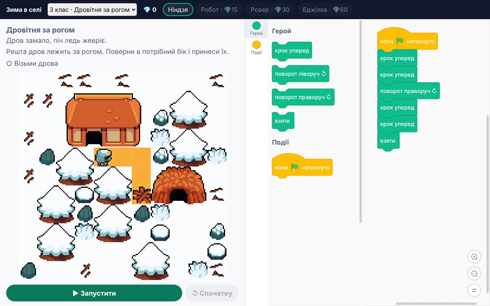

<h1 align="center">edu-blocks</h1>

<p align="center">
  <b>A game-based block programming trainer for grades 3–6, with Scratch 3-style blocks.</b><br>
  Students program a ninja through a winter village, carry firewood, catch fish and earn stars. Programs are graded by a small deterministic interpreter that also runs on the server.
</p>

<p align="center">
  <a href="https://github.com/zavada123/edu-blocks/actions/workflows/pages.yml"></a>
  <a href="https://zavada123.github.io/edu-blocks/"></a>
  <a href="LICENSE"></a>
  
  
</p>

<p align="center">
  <a href="https://zavada123.github.io/edu-blocks/"><b>Live demo</b></a> ·
  <a href="https://github.com/zavada123/edu-blocks/actions/workflows/pages.yml"><b>CI &amp; deploys</b></a> ·
  <a href="#installation">Installation</a> ·
  <a href="#usage">Usage</a> ·
  <a href="#api">API</a>
</p>

<p align="center">
  <a href="https://zavada123.github.io/edu-blocks/"></a>
</p>

## Why

Young students meet programming through Scratch, but a free-form Scratch project is hard to grade. `edu-blocks` keeps the exact look and wording of Ukrainian Scratch 3 blocks and wraps them in short levels with a clear goal and a reason for it: the stove went out, so fetch the firewood; the tea needs water, so walk to the well. A level gives 1–3 stars, and shorter programs earn more. The same check runs in the browser and on your server, so the student always sees the grade the server will give.

The student-facing interface is in Ukrainian. It was built for [EduProstir](https://eduprostir.com), a Ukrainian learning platform. The demo's crystal rewards and small hero shop are only an example: in EduProstir the server awards them.

## Features

- **Real Scratch 3 blocks:** the same shapes and the same Ukrainian names ("повторити", "якщо … то", "інакше", "повторити до", "не", "коли прапорець натиснуто"), so students move to real Scratch easily.
- **Hero blocks:** "step forward", "turn left", "turn right", "take", and the sensing questions "wall ahead?", "anything here?", "reached the goal?".
- **One concept per level:** every level unlocks only its own blocks.
- **Animated runs on a canvas:** the hero walks, swings, lifts what it takes, bumps into walls and falls into traps; enemies walk up, raise their weapons and strike. The block that makes each action lights up.
- **A time line under the field:** pause, a step back or forward, a slider to any moment of the run, and the speed from ×0.5 to ×4. The block of the action on the field lights up as the student steps through, so they see what each block did.
- **Story scenes** (`scene`): summer or winter, a path, pond ice or a bridge, items (crystals, firewood, apples, fish, a key, campfires that light up), a goal (flag, well, grandma, home) and houses around. Pixel art from Ninja Adventure.
- **A meadow around every level** doubles the cells on the map; it is scenery only.
- **XP and hero levels:** a run gives XP for the level tier (`tier`: intro, practice or challenge), for each star and for a pass at the first try. The hero gets only the part above the best earlier run, so replays give nothing to farm.
- **Clear feedback:** the hero hit an obstacle, the program ended too early, the loop never ends. Each level has a hint.
- **Mobile-first layout:** field on top, blocks below, a palette without the category column, drag blocks with a finger.
- **Large mode** for grade 3.
- **Four hero skins** (`skin`): ninja (default), robot, rover and bee. Your app decides how they are sold or unlocked.
- **Python code, as in Tynker or CodeCombat** (`edu-blocks/python`): the same levels with a code editor instead of blocks. `hero.move()`, `while not hero.at_finish():`, functions, variables and lists; the line the hero acts on lights up, and every mistake is explained in Ukrainian with its line.
- **Deterministic grading:** an interpreter that follows Scratch 3's execution order, tested against the TurboWarp VM on hundreds of random programs.

## Installation

Install straight from GitHub and pin a commit. The built package is committed in `lib/`, so nothing is compiled on install.

```bash
npm install github:zavada123/edu-blocks#<commit>
```

`edu-blocks/react` already bundles the Scratch VM and the block editor, so your bundler needs no extra configuration. Peer dependencies: `react` and `react-dom` 19 or newer.

Block icons live in `edu-blocks/blocks-media/`. Copy them to your site's public folder and pass that path as `media`.

## Usage

### Describe a level

A level is a `Level`: the map, the available blocks and the goal. No code is needed.

```ts
import type { Level } from "edu-blocks/core"

const level: Level = {
  id: "g4-repeat",
  grade: 4,
  title: "Повторення",
  task: ["Збери всі п'ять кристалів.", "Спробуй блок «повторити»: так програма буде коротшою."],
  // # wall, . floor, S start, c crystal, F flag. The hero starts facing right (dir changes that).
  map: ["#############", "#S.c.c.c.c.c#", "#############"],
  blocks: ["move", "collect", "repeat"],
  goals: [{ type: "crystals" }],
  // Most blocks allowed for three and for two stars. The "when flag clicked" hat is not counted.
  stars: { three: 4, two: 10 },
  hint: "Знайди дії, які повторюються: «крок, крок, зібрати». Поклади їх у «повторити»."
}
```

- **Goals** (`goals`): `crystals` (take every item on a `c` cell), `finish` (stand on the `F` cell).
- **Scene** (`scene`, optional): `theme` (`summer`, `winter`), `ground` (`path`, `ice`, `bridge`), `item` (`crystal`, `wood`, `apple`, `fish`, `key`, `campfire`), `finish` (`flag`, `well`, `grandma`, `home`) and `props` (`house`, `woodshed` with `x`, `y` in cells). It changes only the looks and the goal text, never the rules.
- **Blocks** (`blocks`): `move`, `turnLeft`, `turnRight`, `collect`, `wallAhead`, `onCrystal`, `atFinish`, `repeat`, `forever`, `repeatUntil`, `if`, `ifElse`, `not`, `and`, `or`.

Every built-in level has a reference solution in `src/levels/solutions.ts`, and a test checks that it earns three stars, so a level without a working solution never ships.

### Render the editor

```tsx
import { EduBlocks } from "edu-blocks/react"
import "edu-blocks/style.css"

<EduBlocks
  key={level.id}
  level={level}
  skin="ninja"
  media="/blocks-media/"
  program={savedProgram}
  onComplete={(report) => sendToServer(report)}
/>
```

An empty level title (`title: ""`) is not shown, so your app can render the task text itself.

### Grade on the server

A program is the `blocks` object of a sprite from a Scratch 3 `project.json`. The server should not trust `passed` and `stars` from the browser: it checks the program and counts the stars itself, and only then awards crystals.

```ts
import { judgeProgram, levels } from "edu-blocks/core"

const result = judgeProgram(level, report.program)
result.passed  // all goals met
result.stars   // 0–3
result.reason  // null, "crashed", "goalsNotMet", "tooLong", "noStart" or "badProgram"
```

XP uses the same pure functions on both sides. Count `firstTry` from your own record of earlier failed runs:

```ts
import { heroLevelOf, xpFor, xpGain } from "edu-blocks/core"

const xp = xpFor(level.tier ?? "intro", { stars: result.stars, firstTry })  // tier XP + 5 per star + 10 for the first try
const gain = xpGain(xp, bestXpOfThisLevel)                 // only the part above the best earlier run
heroLevelOf(totalXp)                                        // { level, from, next }
```

`judgeProgram` is a small interpreter for the level blocks with no Scratch VM: it is synchronous, takes milliseconds and does not need `scratch-vm` on the server. The browser uses the same function, so the student sees exactly the server's result. It follows Scratch 3's execution order: every "when flag clicked" script is its own thread, and threads take turns running one loop iteration each.

Programs are limited to 300 blocks, the blocks of the level and 1,000 hero actions. An infinite loop is stopped by a step count rather than a timer, so the result is the same on a server and on a slow phone. A broken program (blocks linked in a cycle) is stopped too.

## API

| Entry point | Contents |
|---|---|
| `edu-blocks/react` | The `EduBlocks` component and the `EduBlocksProps`, `BlocksReport`, `HeroXp` and `Skin` types |
| `edu-blocks/python` | The `EduPython` component (Python code instead of blocks) and its `EduPythonProps` and `PythonReport` types. It loads neither the Scratch VM nor the block editor |
| `edu-blocks/core` | Built-in `levels` and `solutions`, `judgeProgram`, `judgePython`, `PYTHON_METHODS`, `checkProgram`, `adviseRun`, the level kit, the XP functions, the world model and limits. No React and no VM, safe for Node |
| `edu-blocks/style.css` | Styles of the game screen, with its fonts inside (about 150 kB) |
| `edu-blocks/blocks-media/*` | Block icons to serve from your site |

### `<EduBlocks>` props

| Prop | Description |
|---|---|
| `level` | The level. To show another one, change the component `key` |
| `skin` | Hero look: `ninja` (default), `robot`, `rover` or `bee` |
| `large` | Bigger blocks and field for grade 3 |
| `program` | A saved program: the student continues where they left off |
| `media` | Path to the block icons, with a trailing slash |
| `speed` | Milliseconds per hero action at ×1, 400 by default; the student changes the speed on the time line |
| `xp` | The hero's XP before the run: `{ total, best }`, where `best` is the best XP of this level. The result then shows the gain and the bar to the next hero level |
| `onComplete(report)` | After every run: `levelId`, `passed`, `stars`, `blocks`, `reason`, `firstTry`, `xp` and the `program` itself |
| `onProgramChange(program)` | After every block change, for apps with their own Check button |
| `onMap()` | Shows «← Мапа» in the bar over the game, to go back to the course |
| `onNext()` | Shows «Далі →» in the result of a passed run, to open the next level |
| `progress` | Stars of the passed levels by level id: the bar marks the passed levels of the chapter |

### Game screen

Both components draw the same screen in a pixel frame of wood, parchment and slate: a bar with the chapter, its levels
and the hero's level and XP; the field with its time line and buttons; the task with goals that tick as the hero meets
them; the editor; and the result over the field. The colours, fonts and parts are tokens in
[`src/ui/theme.css`](src/ui/theme.css). The screen fills the height of its box (at least 520 px); in a box lower than
760 px the task and the code bar get smaller, and in a window narrower than 760 px the parts stand in one column.

### Enemies and bosses

A level can put enemies on floor cells with `enemies` and give the hero `hearts` (3 by default). The game stays
turn-based: after each hero action (a turn too) every enemy takes its turn.

```ts
enemies: [
  { kind: "goblin", x: 4, y: 1, walk: "across", sight: 2 }, // walks left and right, comes when the hero is 2 cells away
  { kind: "bear", x: 6, y: 3, boss: true, hp: 3, sight: 3 }  // a boss: bigger, shows its hit points, hits back while struck
],
hearts: 3,
goals: [{ type: "enemies" }, { type: "finish" }]
```

- `walk`: `stand`, `across` or `updown` while the hero is far. `sight` (X): within X steps the enemy walks up to the
  hero, around walls too; 0 means it never comes.
- An enemy next to the hero swings, and on its next turn hits for one heart. A blow stops a plain enemy's swing, not a boss's.
- Blocks `attack` («вдарити») and `enemyAhead` («попереду ворог?»). Walking into an enemy is a crash; no hearts left is the
  fail reason `defeated`.
- Kinds: `slime`, `spirit`, `goblin`, `skull`, `flame`, `bear`, `toad` (Ninja Adventure monsters).

### Hero API and run frames

Every way of programming drives the hero through one API in `edu-blocks/core`, so the game does not depend on the
language: the block interpreter, the Scratch VM and the Python interpreter all use it.

| Export | What it is |
|---|---|
| `HERO_ACTIONS` | The actions: `move`, `turnLeft`, `turnRight`, `collect`, `attack` |
| `HERO_SENSORS` | The questions and how the world answers them: `wallAhead`, `onCrystal`, `atFinish`, `enemyAhead`, `trapAhead` |
| `newSession(level)`, `heroAct(level, session, action, source)`, `heroSense(session, sensor)` | Run a level step by step: `heroAct` returns `true` once the run is over |

Each frame of a `RunResult` has the `action`, its `outcome`, the `blockId` that made it, the `world` after it, the
`goals` met so far (in the order of `level.goals`) and the `events` in the order they happened: `heroMoved`,
`heroTurned`, `heroBumped`, `heroFell`, `heroTired`, `itemTaken`, `nothingToTake`, `heroSwung`, `enemyHit`,
`enemyDown`, `enemyMoved`, `enemyWindUp` and `heroHurt`. An animation can play the events instead of guessing them
from two worlds. On a level with the counter a frame also has `counter`, the value after the action, and a frame of a
Python run has `line`, the line of the program that made it.

### Python

`<EduPython>` plays the same levels with Python code. The field and the time line are the same; the code editor
(CodeMirror) shows the methods of the level above the code, and a tap puts one at the cursor. Its props are those of
`<EduBlocks>` with `source` (a saved program) and `onSourceChange(source)` instead of `program`,
`onProgramChange` and `media`; `onComplete` gets `source` and `size` instead of `program` and `blocks`.

```tsx
import { EduPython } from "edu-blocks/python"
import "edu-blocks/style.css"

<EduPython key={level.id} level={level} source={saved} onComplete={(report) => sendToServer(report)} />
```

On the server, grade the text with `judgePython(level, report.source)`: it returns the same `RunResult` as
`judgeProgram`, with `line` for a mistake and `output` for what the program printed.

| The hero in Python | Block |
|---|---|
| `hero.move()`, `hero.move(3)` | крок уперед |
| `hero.turn_left()`, `hero.turn_right()` | поворот ліворуч / праворуч |
| `hero.collect()`, `hero.attack()` | взяти, вдарити |
| `hero.wall_ahead()`, `hero.item_here()`, `hero.at_finish()`, `hero.enemy_ahead()`, `hero.trap_ahead()` | the questions |

A level opens the methods of its blocks; any other method is a mistake that says so. The language is the part of
Python a course needs, run by a small interpreter in TypeScript (`src/core/python`), with no Pyodide: numbers, texts,
`True`/`False`/`None`, lists with `append` and `pop`, `if`/`elif`/`else`, `while`, `for … in`, `break`, `continue`,
`def` with `return` and `global`, `and`/`or`/`not`, chained comparisons, and `range`, `len`, `print`, `abs`, `min`,
`max`, `sum`, `str`, `int`, `bool`. Words such as `import` or `class` get a message that the course does not need them.

A run is limited to 200,000 interpreter steps, 100 nested calls and 1,000 hero actions, so an endless loop ends with
`tooLong` the same way on a server and on a phone. Stars count the program like its blocks (`programSize`): a
statement, a call, a variable and an operator are one each, numbers and texts are free, and `while not …:` is one
«повторити до». The tests check that every level's solution and hundreds of random programs, written as blocks and
as Python, play the same frames and earn the same stars.

### Counter and custom blocks

Two palette names bring Scratch blocks beyond the hero:

- `"counter"`: «надати лічильник значення», «змінити лічильник на» and the (лічильник) reporter, as «Змінні» in
  Scratch. There is one variable, `eb-counter`; it is 0 at the start of every run. «повторити (лічильник)» takes the
  count once, when the loop starts.
- `"procedure"`: the «визначити» hat of one custom block and its call, as «Мої блоки». The name comes from
  `level.procedure` («мій блок» by default). The student does not make new blocks or arguments; a block may call
  itself. «Без оновлення екрана» is refused, since in Scratch it depends on the clock.

In code, `buildProgram` takes `{ set: n }`, `{ change: n }`, `{ repeat: "counter", body }` and `"call"`, and a second
argument with the custom block: `buildProgram(["call", "call"], { name: "обійти", body: [...] })`. The interpreter
keeps a stack of frames for each script, as the VM does, and the tests compare it with the VM on random programs that
use both.

### Level editor and level kit

`editor.html` (link «Редактор рівнів» in the demo) is a visual level editor. Paint the map with the pack pictures (path, wall, item, goal, start, a house or a woodshed), pick the season, floor, items and goal, the palette blocks and the star limits. The editor checks the level as you go, lets you try it in the trainer (a passed run can set the three-star limit) and gives the level as code for `src/levels/index.ts` or as JSON. Work is kept in the browser.

The same tools are in `edu-blocks/core` for scripts and servers:

| Function | What it does |
|---|---|
| `emptyMap(w, h)`, `setTile(map, x, y, tile)`, `resizeMap(map, w, h)`, `tileAt(map, x, y)` | Make and change a map; one start and one goal are kept |
| `checkLevel(level)` | Errors that keep a level from being played (no start, items cut off by walls, a goal without its block…) and warnings |
| `plainRoute(level)` | A route without loops that passes the level, or `null` |
| `levelSource(level)` | The level as code for `src/levels/index.ts` |
| `adviseRun(level, program, result)` | Advice after a run: what is missing and what is extra in this program |

## Development

```bash
npm install
npm run dev        # demo at http://localhost:5173 (?level=g4-if&solve opens a level with its solution, /editor.html is the level editor)
npm test           # core and reference-solution tests (Vitest)
npm run build      # type check and build the demo into dist/
npm run build:lib  # build the package into lib/ (commit lib/ with your changes)
```

Every push to `main` runs the tests and deploys the demo to GitHub Pages: see the [workflow runs](https://github.com/zavada123/edu-blocks/actions/workflows/pages.yml).

## License and third-party code

The package code is [MIT](LICENSE). It uses:

- [TurboWarp scratch-vm](https://github.com/TurboWarp/scratch-vm) — the engine the editor keeps the program in. It is bundled into `edu-blocks/react`; `edu-blocks/core` does not need it. Licensed under MPL-2.0; the package does not modify the engine.
- [scratch-blocks](https://github.com/scratchfoundation/scratch-blocks) 1.3.0 — the block editor. Licensed under Apache-2.0, block translations under BSD-3-Clause. TurboWarp's fork of scratch-blocks is GPL-3.0, so it is not used.

The fonts are [Tiny5](https://github.com/Gissio/font_tiny5), [Golos Text](https://github.com/googlefonts/golos-text) and [JetBrains Mono](https://github.com/JetBrains/JetBrainsMono), under the SIL Open Font License 1.1 ([`src/ui/fonts`](src/ui/fonts)); the package has only their Latin and Cyrillic letters.

The pixel art of the field (heroes, trees, houses, items) comes from [Ninja Adventure](https://pixel-boy.itch.io/ninja-adventure-asset-pack) by Pixel-boy, released under CC0; [`src/ui/sprites/CREDITS.md`](src/ui/sprites/CREDITS.md) lists where each file comes from, and [`src/ui/sprites/ASSETS.md`](src/ui/sprites/ASSETS.md) gives the size, frames and role of each sprite. [`docs/assets/ninja-adventure.json`](docs/assets/ninja-adventure.json) describes every file of the pack. Scratch, the Scratch Cat and other Scratch characters are trademarks of MIT; this trainer does not use them and is not affiliated with the Scratch Foundation.
