# Tiny Swords (Update 010): каталог спрайтів

Стара версія Tiny Swords від Pixel Frog (Update 010), ліцензія CC0: можна викладати й змінювати без умов. Вигляд згори з легким нахилом: земля намальована згори, люди й будівлі збоку. Одна клітинка поля = 64×64. Лицарі (синій, фіолетовий, червоний, жовтий) і гобліни тих самих кольорів; персонажі дивляться праворуч, ліворуч їх віддзеркалюють (`mirror`). Порядок шарів карти: вода → піна → плоска земля → тінь скелі → плато → стіни скель → об'єкти за `anchor` згори вниз. `anchor` — точка, якою спрайт стоїть на землі (в пікселях кадру), `bounds` — видима частина кадру.

Спрайтів: 151. Клітинка поля: 64×64 пікселів.

## animal

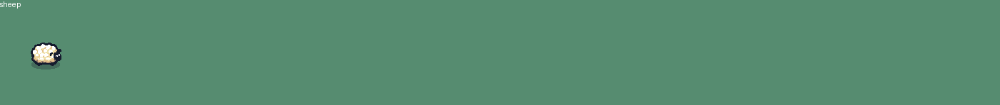

| id | Назва | Що це | Розмір / кадр | Анімації | Ролі |
| --- | --- | --- | --- | --- | --- |
| `animal/sheep` | Вівця | Біла пухнаста вівця: пасеться, підстрибує від радості. Мешканець ферми, джерело м'яса. | 1024×256 / 128×128 | `idle` (8), `bounce` (6) | animal, npc, collectible |

## character

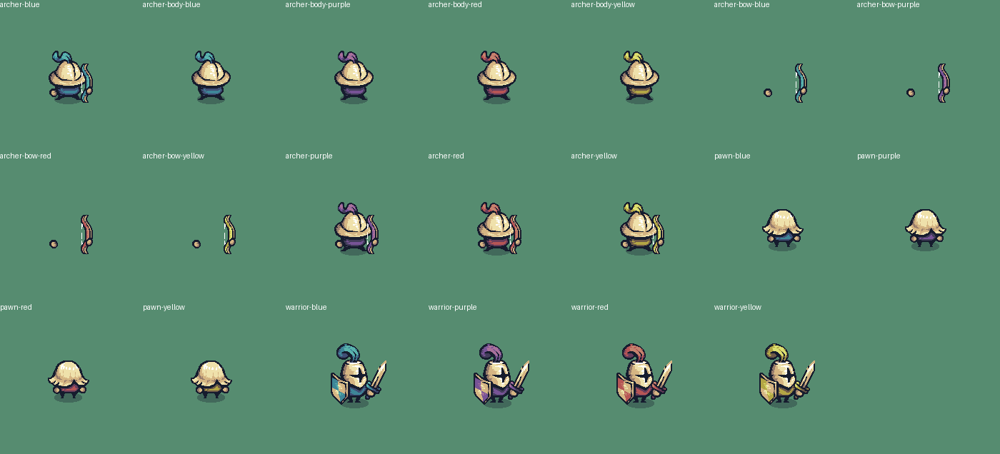

| id | Назва | Що це | Розмір / кадр | Анімації | Ролі |
| --- | --- | --- | --- | --- | --- |
| `character/archer-blue` | Лучник (синій) | Лучник у світлому шоломі з синім пером і з луком: стріляє вгору, навскіс угору, вперед, навскіс униз і вниз. | 1536×1344 / 192×192 | `idle` (6), `run` (6), `shoot-up` (8), `shoot-up-side` (8), `shoot` (8), `shoot-down-side` (8), `shoot-down` (8) | hero, npc |
| `character/archer-body-blue` | Тіло лучника (синій) | Лучник без рук і лука, шар під `character/archer-bow`: так лук можна повернути на будь-який кут. | 1152×384 / 192×192 | `idle` (6), `shoot` (6) | hero, npc |
| `character/archer-body-purple` | Тіло лучника (фіолетовий) | Лучник без рук і лука, шар під `character/archer-bow`: так лук можна повернути на будь-який кут. | 1152×384 / 192×192 | `idle` (6), `shoot` (6) | hero, npc |
| `character/archer-body-red` | Тіло лучника (червоний) | Лучник без рук і лука, шар під `character/archer-bow`: так лук можна повернути на будь-який кут. | 1152×384 / 192×192 | `idle` (6), `shoot` (6) | hero, npc |
| `character/archer-body-yellow` | Тіло лучника (жовтий) | Лучник без рук і лука, шар під `character/archer-bow`: так лук можна повернути на будь-який кут. | 1152×384 / 192×192 | `idle` (6), `shoot` (6) | hero, npc |
| `character/archer-bow-blue` | Лук і руки лучника (синій) | Руки з луком, шар над `character/archer-body`; повертати навколо плеча лучника. | 1536×384 / 192×192 | `idle` (1), `shoot` (8) | hero, npc |
| `character/archer-bow-purple` | Лук і руки лучника (фіолетовий) | Руки з луком, шар над `character/archer-body`; повертати навколо плеча лучника. | 1536×384 / 192×192 | `idle` (1), `shoot` (8) | hero, npc |
| `character/archer-bow-red` | Лук і руки лучника (червоний) | Руки з луком, шар над `character/archer-body`; повертати навколо плеча лучника. | 1536×384 / 192×192 | `idle` (1), `shoot` (8) | hero, npc |
| `character/archer-bow-yellow` | Лук і руки лучника (жовтий) | Руки з луком, шар над `character/archer-body`; повертати навколо плеча лучника. | 1536×384 / 192×192 | `idle` (1), `shoot` (8) | hero, npc |
| `character/archer-purple` | Лучник (фіолетовий) | Лучник у світлому шоломі з фіолетовим пером і з луком: стріляє вгору, навскіс угору, вперед, навскіс униз і вниз. | 1536×1344 / 192×192 | `idle` (6), `run` (6), `shoot-up` (8), `shoot-up-side` (8), `shoot` (8), `shoot-down-side` (8), `shoot-down` (8) | hero, npc |
| `character/archer-red` | Лучник (червоний) | Лучник у світлому шоломі з червоним пером і з луком: стріляє вгору, навскіс угору, вперед, навскіс униз і вниз. | 1536×1344 / 192×192 | `idle` (6), `run` (6), `shoot-up` (8), `shoot-up-side` (8), `shoot` (8), `shoot-down-side` (8), `shoot-down` (8) | hero, npc |
| `character/archer-yellow` | Лучник (жовтий) | Лучник у світлому шоломі з жовтим пером і з луком: стріляє вгору, навскіс угору, вперед, навскіс униз і вниз. | 1536×1344 / 192×192 | `idle` (6), `run` (6), `shoot-up` (8), `shoot-up-side` (8), `shoot` (8), `shoot-down-side` (8), `shoot-down` (8) | hero, npc |
| `character/pawn-blue` | Трудівник (синій) | Білявий селянин-робітник у синьому одязі: будує молотом, рубає дерево сокирою, носить ресурс над головою. Мирний герой або мешканець села. | 1152×1152 / 192×192 | `idle` (6), `run` (6), `build` (6), `chop` (6), `carry-idle` (6), `carry-run` (6) | hero, npc |
| `character/pawn-purple` | Трудівник (фіолетовий) | Білявий селянин-робітник у фіолетовому одязі: будує молотом, рубає дерево сокирою, носить ресурс над головою. Мирний герой або мешканець села. | 1152×1152 / 192×192 | `idle` (6), `run` (6), `build` (6), `chop` (6), `carry-idle` (6), `carry-run` (6) | hero, npc |
| `character/pawn-red` | Трудівник (червоний) | Білявий селянин-робітник у червоному одязі: будує молотом, рубає дерево сокирою, носить ресурс над головою. Мирний герой або мешканець села. | 1152×1152 / 192×192 | `idle` (6), `run` (6), `build` (6), `chop` (6), `carry-idle` (6), `carry-run` (6) | hero, npc |
| `character/pawn-yellow` | Трудівник (жовтий) | Білявий селянин-робітник у жовтому одязі: будує молотом, рубає дерево сокирою, носить ресурс над головою. Мирний герой або мешканець села. | 1152×1152 / 192×192 | `idle` (6), `run` (6), `build` (6), `chop` (6), `carry-idle` (6), `carry-run` (6) | hero, npc |
| `character/warrior-blue` | Воїн (синій) | Лицар у шоломі з синім пером, з мечем і щитом. Головний герой або охоронець: стоїть, біжить, б'є мечем праворуч, униз і вгору (по два різні удари). | 1152×1536 / 192×192 | `idle` (6), `run` (6), `attack` (6), `attack-2` (6), `attack-down` (6), `attack-down-2` (6), `attack-up` (6), `attack-up-2` (6) | hero, npc |
| `character/warrior-purple` | Воїн (фіолетовий) | Лицар у шоломі з фіолетовим пером, з мечем і щитом. Головний герой або охоронець: стоїть, біжить, б'є мечем праворуч, униз і вгору (по два різні удари). | 1152×1536 / 192×192 | `idle` (6), `run` (6), `attack` (6), `attack-2` (6), `attack-down` (6), `attack-down-2` (6), `attack-up` (6), `attack-up-2` (6) | hero, npc |
| `character/warrior-red` | Воїн (червоний) | Лицар у шоломі з червоним пером, з мечем і щитом. Головний герой або охоронець: стоїть, біжить, б'є мечем праворуч, униз і вгору (по два різні удари). | 1152×1536 / 192×192 | `idle` (6), `run` (6), `attack` (6), `attack-2` (6), `attack-down` (6), `attack-down-2` (6), `attack-up` (6), `attack-up-2` (6) | hero, npc |
| `character/warrior-yellow` | Воїн (жовтий) | Лицар у шоломі з жовтим пером, з мечем і щитом. Головний герой або охоронець: стоїть, біжить, б'є мечем праворуч, униз і вгору (по два різні удари). | 1152×1536 / 192×192 | `idle` (6), `run` (6), `attack` (6), `attack-2` (6), `attack-down` (6), `attack-down-2` (6), `attack-up` (6), `attack-up-2` (6) | hero, npc |

## decor

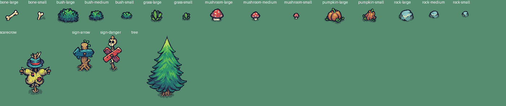

| id | Назва | Що це | Розмір / кадр | Анімації | Ролі |
| --- | --- | --- | --- | --- | --- |
| `decor/bone-large` | Кістка | Велика кістка на землі. | 64×64 | — | decor |
| `decor/bone-small` | Кісточка | Маленька кістка. | 64×64 | — | decor |
| `decor/bush-large` | Великий кущ | Великий густий кущ, через нього не пройти. | 64×64 | — | obstacle |
| `decor/bush-medium` | Кущ | Зелений кущ. | 64×64 | — | decor, obstacle |
| `decor/bush-small` | Кущик | Маленький зелений кущ. | 64×64 | — | decor |
| `decor/grass-large` | Трава | Високий пучок трави. | 64×64 | — | decor |
| `decor/grass-small` | Травичка | Невеликий пучок трави. | 64×64 | — | decor |
| `decor/mushroom-large` | Великий гриб | Великий червоний мухомор із білими цятками. | 64×64 | — | decor, obstacle |
| `decor/mushroom-medium` | Гриб | Червоний мухомор. | 64×64 | — | decor |
| `decor/mushroom-small` | Маленький гриб | Крихітний червоний мухомор. | 64×64 | — | decor |
| `decor/pumpkin-large` | Гарбуз | Великий помаранчевий гарбуз. | 64×64 | — | decor, collectible, obstacle |
| `decor/pumpkin-small` | Гарбузик | Маленький помаранчевий гарбуз на грядці. | 64×64 | — | decor, collectible |
| `decor/rock-large` | Великий камінь | Великий валун, через нього не пройти. | 64×64 | — | obstacle |
| `decor/rock-medium` | Камінь | Середній камінь. | 64×64 | — | decor, obstacle |
| `decor/rock-small` | Камінчик | Маленький сіро-блакитний камінь. | 64×64 | — | decor |
| `decor/scarecrow` | Опудало | Опудало в капелюсі на полі. Займає 3×3 клітинки малюнка, стоїть на одній. | 192×192 | — | decor, obstacle, npc |
| `decor/sign-arrow` | Дороговказ | Дерев'яний стовп зі стрілкою: дороговказ. Дві клітинки заввишки. | 64×128 | — | decor, goal |
| `decor/sign-danger` | Знак небезпеки | Дерев'яний знак: хрест із дощок і череп. Попереджає про небезпеку. Дві клітинки заввишки. | 64×128 | — | decor, obstacle, goal |
| `decor/tree` | Ялина | Висока ялина, що гойдається на вітрі; від удару сокирою тремтить, потім лишається пеньок. Стоїть на одній клітинці, крона закриває клітинку вище. | 768×576 / 192×192 | `idle` (4), `hit` (2), `stump` (1) | obstacle, decor |

## effect

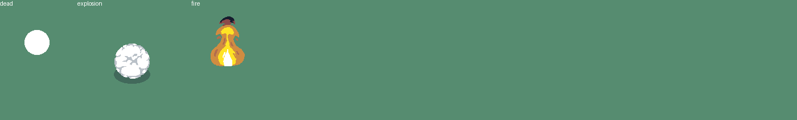

| id | Назва | Що це | Розмір / кадр | Анімації | Ролі |
| --- | --- | --- | --- | --- | --- |
| `effect/dead` | Череп переможеного | Спалах і череп, що лишається на місці переможеного персонажа, потім іде в землю. | 896×256 / 128×128 | `die` (7), `fade` (7) | effect |
| `effect/explosion` | Вибух | Вибух динаміту чи бочки: вогонь і дим. | 1728×192 / 192×192 | `play` (9) | effect |
| `effect/fire` | Вогонь | Полум'я, що горить на місці: вогнище, пожежа будинку. | 896×128 / 128×128 | `play` (7) | effect, obstacle |

## enemy

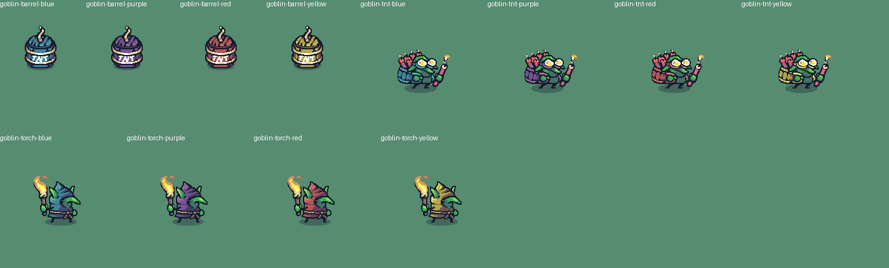

| id | Назва | Що це | Розмір / кадр | Анімації | Ролі |
| --- | --- | --- | --- | --- | --- |
| `enemy/goblin-barrel-blue` | Гоблін у бочці (синій) | Кольорова бочка з написом TNT і ґнотом, у якій ховається гоблін: визирає, біжить і вибухає. Пастка, що прикидається бочкою. | 768×768 / 128×128 | `hidden` (1), `peek` (6), `out` (1), `hide` (6), `run` (3), `explode` (3) | enemy, obstacle |
| `enemy/goblin-barrel-purple` | Гоблін у бочці (фіолетовий) | Кольорова бочка з написом TNT і ґнотом, у якій ховається гоблін: визирає, біжить і вибухає. Пастка, що прикидається бочкою. | 768×768 / 128×128 | `hidden` (1), `peek` (6), `out` (1), `hide` (6), `run` (3), `explode` (3) | enemy, obstacle |
| `enemy/goblin-barrel-red` | Гоблін у бочці (червоний) | Кольорова бочка з написом TNT і ґнотом, у якій ховається гоблін: визирає, біжить і вибухає. Пастка, що прикидається бочкою. | 768×768 / 128×128 | `hidden` (1), `peek` (6), `out` (1), `hide` (6), `run` (3), `explode` (3) | enemy, obstacle |
| `enemy/goblin-barrel-yellow` | Гоблін у бочці (жовтий) | Кольорова бочка з написом TNT і ґнотом, у якій ховається гоблін: визирає, біжить і вибухає. Пастка, що прикидається бочкою. | 768×768 / 128×128 | `hidden` (1), `peek` (6), `out` (1), `hide` (6), `run` (3), `explode` (3) | enemy, obstacle |
| `enemy/goblin-tnt-blue` | Гоблін-підривник (синій) | Гоблін у льотних окулярах з кольоровим рюкзаком, повним динаміту: кидає динаміт (`weapon/dynamite`), той вибухає (`effect/explosion`). | 1344×576 / 192×192 | `idle` (6), `run` (6), `throw` (7) | enemy |
| `enemy/goblin-tnt-purple` | Гоблін-підривник (фіолетовий) | Гоблін у льотних окулярах з кольоровим рюкзаком, повним динаміту: кидає динаміт (`weapon/dynamite`), той вибухає (`effect/explosion`). | 1344×576 / 192×192 | `idle` (6), `run` (6), `throw` (7) | enemy |
| `enemy/goblin-tnt-red` | Гоблін-підривник (червоний) | Гоблін у льотних окулярах з кольоровим рюкзаком, повним динаміту: кидає динаміт (`weapon/dynamite`), той вибухає (`effect/explosion`). | 1344×576 / 192×192 | `idle` (6), `run` (6), `throw` (7) | enemy |
| `enemy/goblin-tnt-yellow` | Гоблін-підривник (жовтий) | Гоблін у льотних окулярах з кольоровим рюкзаком, повним динаміту: кидає динаміт (`weapon/dynamite`), той вибухає (`effect/explosion`). | 1344×576 / 192×192 | `idle` (6), `run` (6), `throw` (7) | enemy |
| `enemy/goblin-torch-blue` | Гоблін зі смолоскипом (синій) | Зелений гоблін у синьому гостроверхому каптурі з палаючим смолоскипом: ближній бій, б'є вперед, униз і вгору. | 1344×960 / 192×192 | `idle` (7), `run` (6), `attack` (6), `attack-down` (6), `attack-up` (6) | enemy |
| `enemy/goblin-torch-purple` | Гоблін зі смолоскипом (фіолетовий) | Зелений гоблін у фіолетовому гостроверхому каптурі з палаючим смолоскипом: ближній бій, б'є вперед, униз і вгору. | 1344×960 / 192×192 | `idle` (7), `run` (6), `attack` (6), `attack-down` (6), `attack-up` (6) | enemy |
| `enemy/goblin-torch-red` | Гоблін зі смолоскипом (червоний) | Зелений гоблін у червоному гостроверхому каптурі з палаючим смолоскипом: ближній бій, б'є вперед, униз і вгору. | 1344×960 / 192×192 | `idle` (7), `run` (6), `attack` (6), `attack-down` (6), `attack-up` (6) | enemy |
| `enemy/goblin-torch-yellow` | Гоблін зі смолоскипом (жовтий) | Зелений гоблін у жовтому гостроверхому каптурі з палаючим смолоскипом: ближній бій, б'є вперед, униз і вгору. | 1344×960 / 192×192 | `idle` (7), `run` (6), `attack` (6), `attack-down` (6), `attack-up` (6) | enemy |

## item

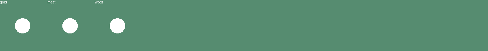

| id | Назва | Що це | Розмір / кадр | Анімації | Ролі |
| --- | --- | --- | --- | --- | --- |
| `item/gold` | Мішечок золота | Мішечок із золотими монетами: скарб, нагорода, те, що збирають. Лежить на землі з тінню; `spawn` — поява з білого спалаху. | 128×128 | `spawn` (7) | collectible |
| `item/meat` | М'ясо | Шматок м'яса: їжа, ресурс. Лежить на землі з тінню; `spawn` — поява з білого спалаху. | 128×128 | `spawn` (7) | collectible |
| `item/wood` | Колода | Колода дров: ресурс, який збирають або несуть додому. Лежить на землі з тінню; `spawn` — поява з білого спалаху. | 128×128 | `spawn` (7) | collectible |

## prop

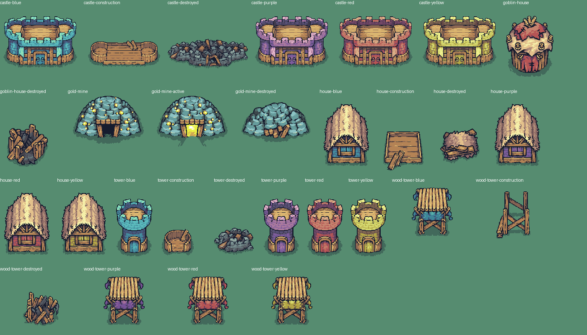

| id | Назва | Що це | Розмір / кадр | Анімації | Ролі |
| --- | --- | --- | --- | --- | --- |
| `prop/castle-blue` | Замок (синій) | Великий замок: кольорові кам'яні мури з зубцями навколо дерев'яного двору, ворота посередині. Головна будівля королівства, мета або база. Колір: синій. | 320×256 | — | building, goal, obstacle |
| `prop/castle-construction` | Замок: будується | Замок: лише дерев'яний фундамент і дошки, ще будується. | 320×256 | — | building, obstacle |
| `prop/castle-destroyed` | Замок: зруйновано | Руїни: замок після пожежі чи нападу. | 320×256 | — | building, obstacle, decor |
| `prop/castle-purple` | Замок (фіолетовий) | Великий замок: кольорові кам'яні мури з зубцями навколо дерев'яного двору, ворота посередині. Головна будівля королівства, мета або база. Колір: фіолетовий. | 320×256 | — | building, goal, obstacle |
| `prop/castle-red` | Замок (червоний) | Великий замок: кольорові кам'яні мури з зубцями навколо дерев'яного двору, ворота посередині. Головна будівля королівства, мета або база. Колір: червоний. | 320×256 | — | building, goal, obstacle |
| `prop/castle-yellow` | Замок (жовтий) | Великий замок: кольорові кам'яні мури з зубцями навколо дерев'яного двору, ворота посередині. Головна будівля королівства, мета або база. Колір: жовтий. | 320×256 | — | building, goal, obstacle |
| `prop/goblin-house` | Хатина гоблінів | Кругла хатина гоблінів з колод під червоним латаним дахом із кістками. | 128×192 | — | building, obstacle, goal |
| `prop/goblin-house-destroyed` | Хатина гоблінів: зруйновано | Розвалена хатина гоблінів. | 128×192 | — | building, obstacle, decor |
| `prop/gold-mine` | Золота копальня | Купол із каменів із золотими вкрапленнями й темним входом у копальню. | 192×128 | — | building, goal, obstacle |
| `prop/gold-mine-active` | Золота копальня: працює | Копальня зі світлом у вході: тут видобувають золото. | 192×128 | — | building, goal, obstacle |
| `prop/gold-mine-destroyed` | Золота копальня: обвалилась | Завалений вхід у копальню. | 192×128 | — | building, goal, obstacle |
| `prop/house-blue` | Будинок (синій) | Хата з солом'яним дахом і кольоровими стінами, двері й вікно спереду: дім героя чи селян. Колір: синій. | 128×192 | — | building, goal, obstacle |
| `prop/house-construction` | Будинок: будується | Будинок: лише дерев'яний фундамент і дошки, ще будується. | 128×192 | — | building, obstacle |
| `prop/house-destroyed` | Будинок: зруйновано | Руїни: будинок після пожежі чи нападу. | 128×192 | — | building, obstacle, decor |
| `prop/house-purple` | Будинок (фіолетовий) | Хата з солом'яним дахом і кольоровими стінами, двері й вікно спереду: дім героя чи селян. Колір: фіолетовий. | 128×192 | — | building, goal, obstacle |
| `prop/house-red` | Будинок (червоний) | Хата з солом'яним дахом і кольоровими стінами, двері й вікно спереду: дім героя чи селян. Колір: червоний. | 128×192 | — | building, goal, obstacle |
| `prop/house-yellow` | Будинок (жовтий) | Хата з солом'яним дахом і кольоровими стінами, двері й вікно спереду: дім героя чи селян. Колір: жовтий. | 128×192 | — | building, goal, obstacle |
| `prop/tower-blue` | Вежа (синій) | Кругла вартова вежа з кольорового каменю з зубцями й дверима. Колір: синій. | 128×256 | — | building, goal, obstacle |
| `prop/tower-construction` | Вежа: будується | Вежа: лише дерев'яний фундамент і дошки, ще будується. | 128×256 | — | building, obstacle |
| `prop/tower-destroyed` | Вежа: зруйновано | Руїни: вежа після пожежі чи нападу. | 128×256 | — | building, obstacle, decor |
| `prop/tower-purple` | Вежа (фіолетовий) | Кругла вартова вежа з кольорового каменю з зубцями й дверима. Колір: фіолетовий. | 128×256 | — | building, goal, obstacle |
| `prop/tower-red` | Вежа (червоний) | Кругла вартова вежа з кольорового каменю з зубцями й дверима. Колір: червоний. | 128×256 | — | building, goal, obstacle |
| `prop/tower-yellow` | Вежа (жовтий) | Кругла вартова вежа з кольорового каменю з зубцями й дверима. Колір: жовтий. | 128×256 | — | building, goal, obstacle |
| `prop/wood-tower-blue` | Дерев'яна вежа гоблінів (синій) | Хистка вежа гоблінів на дерев'яних ногах з кольоровою тканиною й прапорцями, що майорять. | 1024×192 / 256×192 | `idle` (4) | building, obstacle, goal |
| `prop/wood-tower-construction` | Вежа гоблінів: будується | Дерев'яна вежа гоблінів: будується. | 256×192 | — | building, obstacle |
| `prop/wood-tower-destroyed` | Вежа гоблінів: зруйновано | Дерев'яна вежа гоблінів: зруйновано. | 256×192 | — | building, obstacle |
| `prop/wood-tower-purple` | Дерев'яна вежа гоблінів (фіолетовий) | Хистка вежа гоблінів на дерев'яних ногах з кольоровою тканиною й прапорцями, що майорять. | 1024×192 / 256×192 | `idle` (4) | building, obstacle, goal |
| `prop/wood-tower-red` | Дерев'яна вежа гоблінів (червоний) | Хистка вежа гоблінів на дерев'яних ногах з кольоровою тканиною й прапорцями, що майорять. | 1024×192 / 256×192 | `idle` (4) | building, obstacle, goal |
| `prop/wood-tower-yellow` | Дерев'яна вежа гоблінів (жовтий) | Хистка вежа гоблінів на дерев'яних ногах з кольоровою тканиною й прапорцями, що майорять. | 1024×192 / 256×192 | `idle` (4) | building, obstacle, goal |

## terrain

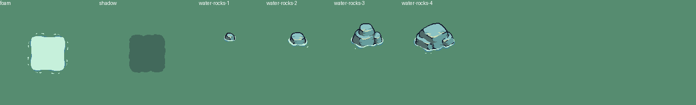

| id | Назва | Що це | Розмір / кадр | Анімації | Ролі |
| --- | --- | --- | --- | --- | --- |
| `terrain/foam` | Піна прибою | Біла піна навколо землі на воді, 3×3 клітинки: центр кадру ставити на клітинку землі, що межує з водою (малюється під землею). | 1536×192 / 192×192 | `play` (8) | water, decor |
| `terrain/shadow` | Тінь скелі | Напівпрозора тінь 3×3 клітинки: класти під кожну плитку плато (центр на ній), щоб скеля відкидала тінь. | 192×192 | — | shadow |
| `terrain/water-rocks-1` | Камені у воді 1 | Маленькі камені у воді з піною навколо. | 1024×128 / 128×128 | `play` (8) | obstacle, decor, water |
| `terrain/water-rocks-2` | Камені у воді 2 | Камені у воді з піною навколо. | 1024×128 / 128×128 | `play` (8) | obstacle, decor, water |
| `terrain/water-rocks-3` | Камені у воді 3 | Скеля з трьох каменів у воді з піною навколо. | 1024×128 / 128×128 | `play` (8) | obstacle, decor, water |
| `terrain/water-rocks-4` | Камені у воді 4 | Великі камені у воді з піною навколо. | 1024×128 / 128×128 | `play` (8) | obstacle, decor, water |

## tileset

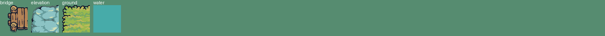

| id | Назва | Що це | Розмір / кадр | Анімації | Ролі |
| --- | --- | --- | --- | --- | --- |
| `tileset/bridge` | Міст | Дерев'яний міст через воду: горизонтальний і вертикальний, цілий і зламаний. | 192×256 / 64×64 | — | bridge, ground, path |
| `tileset/elevation` | Скелі й плато | Підняту землю малюють так: верх плато (рядки 0–2, стовпець 3, рядок 4) — як траву, за `mask`; під нижнім краєм плато ставлять стіну скелі (рядки 3 і 5); сходи (рядок 7) з'єднують плато з низом. Під плато кладуть тінь `terrain/shadow`. | 256×512 / 64×64 | — | ground, cliff, obstacle |
| `tileset/ground` | Плоска земля: трава й пісок | Тайлсет плоскої землі на воді: блок 4×4 трави (стовпці 0–3) і піску (5–8). Кожна плитка має `edges` (боки, де ґрунт закінчується) і `mask` (N=1, E=2, S=4, W=8): для клітинки рахують, з яких боків сусід не той ґрунт, і беруть плитку з таким `mask`. Пісок на траві дає стежку, трава на воді дає острів. | 640×256 / 64×64 | — | ground, path |
| `tileset/water` | Вода | Плитка води: фон під усією картою. Через воду не пройти; береги дає `terrain/foam`. | 64×64 / 64×64 | — | water, obstacle |

### Плитки `tileset/bridge`

| № | Стовпець, рядок | Ґрунт | Роль | Краї | Опис |
| --- | --- | --- | --- | --- | --- |
| 1 | 0, 0 | bridge | horizontal-left | — | Горизонтальний міст: лівий кінець зі стовпчиками |
| 2 | 1, 0 | bridge | horizontal-middle | — | Горизонтальний міст: середина, дошки |
| 3 | 2, 0 | bridge | horizontal-right | — | Горизонтальний міст: правий кінець |
| 4 | 0, 1 | bridge | vertical-top | — | Вертикальний міст: верхній кінець |
| 7 | 0, 2 | bridge | vertical-middle | — | Вертикальний міст: середина |
| 10 | 0, 3 | bridge | vertical-bottom | — | Вертикальний міст: нижній кінець |
| 5 | 1, 1 | bridge | broken | — | Зламаний міст: стовпці й одна дошка |
| 6 | 2, 1 | bridge | broken | — | Зламаний міст: стовпці й дошка навскіс |
| 8 | 1, 2 | bridge | broken | — | Розкидані колоди зламаного мосту |
| 12 | 2, 3 | bridge | shadow | — | Тінь мосту на воді |

### Плитки `tileset/elevation`

| № | Стовпець, рядок | Ґрунт | Роль | Краї | Опис |
| --- | --- | --- | --- | --- | --- |
| 1 | 0, 0 | plateau | edge | NW | Плато (верх скелі): край там, де верх, лівий бік |
| 2 | 1, 0 | plateau | edge | N | Плато (верх скелі): край там, де верх |
| 3 | 2, 0 | plateau | edge | NE | Плато (верх скелі): край там, де верх, правий бік |
| 4 | 3, 0 | plateau | edge | NEW | Плато (верх скелі): край там, де верх, правий бік, лівий бік |
| 5 | 0, 1 | plateau | edge | W | Плато (верх скелі): край там, де лівий бік |
| 6 | 1, 1 | plateau | fill | — | Плато (верх скелі): середина, з усіх боків той самий ґрунт |
| 7 | 2, 1 | plateau | edge | E | Плато (верх скелі): край там, де правий бік |
| 8 | 3, 1 | plateau | edge | EW | Плато (верх скелі): край там, де правий бік, лівий бік |
| 9 | 0, 2 | plateau | edge | SW | Плато (верх скелі): край там, де низ, лівий бік |
| 10 | 1, 2 | plateau | edge | S | Плато (верх скелі): край там, де низ |
| 11 | 2, 2 | plateau | edge | ES | Плато (верх скелі): край там, де правий бік, низ |
| 12 | 3, 2 | plateau | edge | ESW | Плато (верх скелі): край там, де правий бік, низ, лівий бік |
| 17 | 0, 4 | plateau | edge | NSW | Плато в одну клітинку заввишки: лівий край |
| 18 | 1, 4 | plateau | edge | NS | Плато в одну клітинку заввишки: середина |
| 19 | 2, 4 | plateau | edge | NES | Плато в одну клітинку заввишки: правий край |
| 20 | 3, 4 | plateau | edge | NESW | Плато в одну клітинку заввишки: одна клітинка |
| 13 | 0, 3 | cliff | wall | — | Стіна скелі під нижнім рядом плато: лівий край |
| 14 | 1, 3 | cliff | wall | — | Стіна скелі під нижнім рядом плато: середина |
| 15 | 2, 3 | cliff | wall | — | Стіна скелі під нижнім рядом плато: правий край |
| 16 | 3, 3 | cliff | wall | — | Стіна скелі під нижнім рядом плато: одна клітинка |
| 21 | 0, 5 | cliff | wall | — | Стіна скелі під плато в одну клітинку: лівий край |
| 22 | 1, 5 | cliff | wall | — | Стіна скелі під плато в одну клітинку: середина |
| 23 | 2, 5 | cliff | wall | — | Стіна скелі під плато в одну клітинку: правий край |
| 24 | 3, 5 | cliff | wall | — | Стіна скелі під плато в одну клітинку: одна клітинка |
| 29 | 0, 7 | stairs | stairs | — | Сходи з плато вниз: лівий край |
| 30 | 1, 7 | stairs | stairs | — | Сходи з плато вниз: середина |
| 31 | 2, 7 | stairs | stairs | — | Сходи з плато вниз: правий край |
| 32 | 3, 7 | stairs | stairs | — | Сходи з плато вниз: одна клітинка |

### Плитки `tileset/ground`

| № | Стовпець, рядок | Ґрунт | Роль | Краї | Опис |
| --- | --- | --- | --- | --- | --- |
| 1 | 0, 0 | grass | edge | NW | Трава: край там, де верх, лівий бік |
| 2 | 1, 0 | grass | edge | N | Трава: край там, де верх |
| 3 | 2, 0 | grass | edge | NE | Трава: край там, де верх, правий бік |
| 4 | 3, 0 | grass | edge | NEW | Трава: край там, де верх, правий бік, лівий бік |
| 11 | 0, 1 | grass | edge | W | Трава: край там, де лівий бік |
| 12 | 1, 1 | grass | fill | — | Трава: середина, з усіх боків той самий ґрунт |
| 13 | 2, 1 | grass | edge | E | Трава: край там, де правий бік |
| 14 | 3, 1 | grass | edge | EW | Трава: край там, де правий бік, лівий бік |
| 21 | 0, 2 | grass | edge | SW | Трава: край там, де низ, лівий бік |
| 22 | 1, 2 | grass | edge | S | Трава: край там, де низ |
| 23 | 2, 2 | grass | edge | ES | Трава: край там, де правий бік, низ |
| 24 | 3, 2 | grass | edge | ESW | Трава: край там, де правий бік, низ, лівий бік |
| 31 | 0, 3 | grass | edge | NSW | Трава: край там, де верх, низ, лівий бік |
| 32 | 1, 3 | grass | edge | NS | Трава: край там, де верх, низ |
| 33 | 2, 3 | grass | edge | NES | Трава: край там, де верх, правий бік, низ |
| 34 | 3, 3 | grass | edge | NESW | Трава: край там, де верх, правий бік, низ, лівий бік |
| 6 | 5, 0 | sand | edge | NW | Пісок: край там, де верх, лівий бік |
| 7 | 6, 0 | sand | edge | N | Пісок: край там, де верх |
| 8 | 7, 0 | sand | edge | NE | Пісок: край там, де верх, правий бік |
| 9 | 8, 0 | sand | edge | NEW | Пісок: край там, де верх, правий бік, лівий бік |
| 16 | 5, 1 | sand | edge | W | Пісок: край там, де лівий бік |
| 17 | 6, 1 | sand | fill | — | Пісок: середина, з усіх боків той самий ґрунт |
| 18 | 7, 1 | sand | edge | E | Пісок: край там, де правий бік |
| 19 | 8, 1 | sand | edge | EW | Пісок: край там, де правий бік, лівий бік |
| 26 | 5, 2 | sand | edge | SW | Пісок: край там, де низ, лівий бік |
| 27 | 6, 2 | sand | edge | S | Пісок: край там, де низ |
| 28 | 7, 2 | sand | edge | ES | Пісок: край там, де правий бік, низ |
| 29 | 8, 2 | sand | edge | ESW | Пісок: край там, де правий бік, низ, лівий бік |
| 36 | 5, 3 | sand | edge | NSW | Пісок: край там, де верх, низ, лівий бік |
| 37 | 6, 3 | sand | edge | NS | Пісок: край там, де верх, низ |
| 38 | 7, 3 | sand | edge | NES | Пісок: край там, де верх, правий бік, низ |
| 39 | 8, 3 | sand | edge | NESW | Пісок: край там, де верх, правий бік, низ, лівий бік |
| 5 | 4, 0 | grass | detail | — | Кущики трави внизу плитки: класти під нижній край трави, щоб край виглядав живим |
| 10 | 9, 0 | sand | detail | — | Камінці піску внизу плитки, як і для трави |

### Плитки `tileset/water`

| № | Стовпець, рядок | Ґрунт | Роль | Краї | Опис |
| --- | --- | --- | --- | --- | --- |
| 1 | 0, 0 | water | fill | — | Вода |

## ui

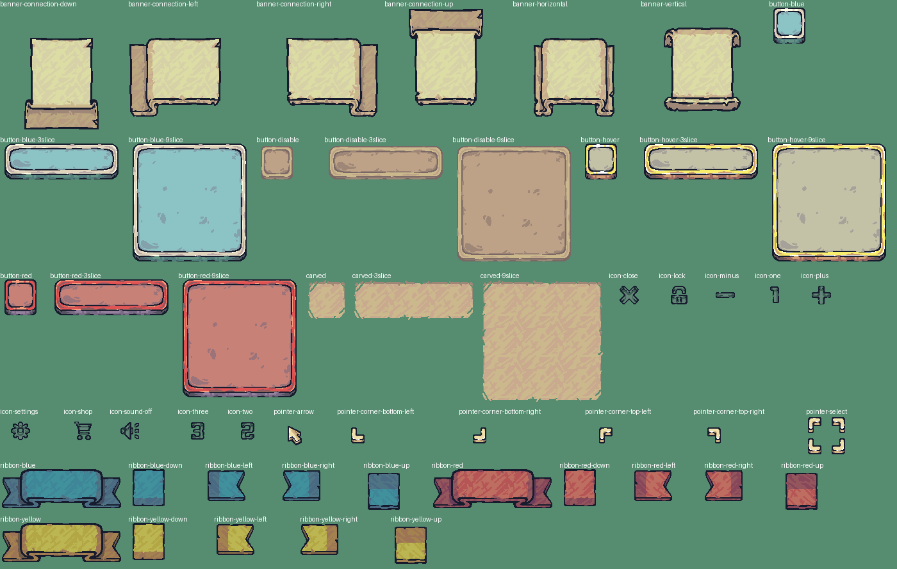

| id | Назва | Що це | Розмір / кадр | Анімації | Ролі |
| --- | --- | --- | --- | --- | --- |
| `ui/banner-connection-down` | Сувій-панель | Сувій зі звивом знизу: з'єднання панелей. 9 частин по 64 пікселі (`parts`). | 192×192 | — | ui-panel |
| `ui/banner-connection-left` | Сувій-панель | Сувій зі звивом зліва. 9 частин по 64 пікселі (`parts`). | 192×192 | — | ui-panel |
| `ui/banner-connection-right` | Сувій-панель | Сувій зі звивом справа. 9 частин по 64 пікселі (`parts`). | 192×192 | — | ui-panel |
| `ui/banner-connection-up` | Сувій-панель | Сувій зі звивом зверху. 9 частин по 64 пікселі (`parts`). | 192×192 | — | ui-panel |
| `ui/banner-horizontal` | Сувій-панель | Сувій, розгорнутий горизонтально: панель для тексту. 9 частин по 64 пікселі (`parts`). | 192×192 | — | ui-panel |
| `ui/banner-vertical` | Сувій-панель | Сувій, розгорнутий вертикально: панель для тексту. 9 частин по 64 пікселі (`parts`). | 192×192 | — | ui-panel |
| `ui/button-blue` | Кнопка синя | Квадратна синя кнопка; `pressed` — натиснута. | 64×64 | — | ui-button |
| `ui/button-blue-3slice` | Кнопка синя, розтяжна | Синя кнопка, нарізана на 3 частини по 64 пікселі для розтягування (`parts`). | 192×64 | — | ui-button, ui-panel |
| `ui/button-blue-9slice` | Кнопка синя, розтяжна | Синя кнопка, нарізана на 9 частини по 64 пікселі для розтягування (`parts`). | 192×192 | — | ui-button, ui-panel |
| `ui/button-disable` | Кнопка: вимкнена | Квадратна кнопка в стані «вимкнена». | 64×64 | — | ui-button |
| `ui/button-disable-3slice` | Кнопка вимкнена, розтяжна | Розтяжна кнопка в стані «вимкнена», 3 частини. | 192×64 | — | ui-button, ui-panel |
| `ui/button-disable-9slice` | Кнопка вимкнена, розтяжна | Розтяжна кнопка в стані «вимкнена», 9 частини. | 192×192 | — | ui-button, ui-panel |
| `ui/button-hover` | Кнопка: під курсором | Квадратна кнопка в стані «під курсором». | 64×64 | — | ui-button |
| `ui/button-hover-3slice` | Кнопка під курсором, розтяжна | Розтяжна кнопка в стані «під курсором», 3 частини. | 192×64 | — | ui-button, ui-panel |
| `ui/button-hover-9slice` | Кнопка під курсором, розтяжна | Розтяжна кнопка в стані «під курсором», 9 частини. | 192×192 | — | ui-button, ui-panel |
| `ui/button-red` | Кнопка червона | Квадратна червона кнопка; `pressed` — натиснута. | 64×64 | — | ui-button |
| `ui/button-red-3slice` | Кнопка червона, розтяжна | Червона кнопка, нарізана на 3 частини по 64 пікселі для розтягування (`parts`). | 192×64 | — | ui-button, ui-panel |
| `ui/button-red-9slice` | Кнопка червона, розтяжна | Червона кнопка, нарізана на 9 частини по 64 пікселі для розтягування (`parts`). | 192×192 | — | ui-button, ui-panel |
| `ui/carved` | Різьблена дошка | Різьблена дошка: тло для тексту чи слоту. | 64×64 | — | ui-panel |
| `ui/carved-3slice` | Різьблена дошка на 3 частини | Різьблена дошка на 3 частини: тло для тексту чи слоту. | 192×64 | — | ui-panel |
| `ui/carved-9slice` | Різьблена панель на 9 частин | Різьблена панель на 9 частин: тло для тексту чи слоту. | 192×192 | — | ui-panel |
| `ui/icon-close` | Закрити | Іконка «закрити» для кнопки; є стани `pressed` і `disabled`. | 64×64 | — | ui-icon |
| `ui/icon-lock` | Замок | Іконка «замок» для кнопки; є стани `pressed` і `disabled`. | 64×64 | — | ui-icon |
| `ui/icon-minus` | Мінус | Іконка «мінус» для кнопки; є стани `pressed` і `disabled`. | 64×64 | — | ui-icon |
| `ui/icon-one` | Цифра 1 | Іконка «цифра 1» для кнопки; є стани `pressed` і `disabled`. | 64×64 | — | ui-icon |
| `ui/icon-plus` | Плюс | Іконка «плюс» для кнопки; є стани `pressed` і `disabled`. | 64×64 | — | ui-icon |
| `ui/icon-settings` | Налаштування | Іконка «налаштування» для кнопки; є стани `pressed` і `disabled`. | 64×64 | — | ui-icon |
| `ui/icon-shop` | Крамниця | Іконка «крамниця» для кнопки; є стани `pressed` і `disabled`. | 64×64 | — | ui-icon |
| `ui/icon-sound-off` | Звук вимкнено | Іконка «звук вимкнено» для кнопки; є стани `pressed` і `disabled`. | 64×64 | — | ui-icon |
| `ui/icon-three` | Цифра 3 | Іконка «цифра 3» для кнопки; є стани `pressed` і `disabled`. | 64×64 | — | ui-icon |
| `ui/icon-two` | Цифра 2 | Іконка «цифра 2» для кнопки; є стани `pressed` і `disabled`. | 64×64 | — | ui-icon |
| `ui/pointer-arrow` | Курсор-стрілка | Курсор-стрілка: показує клітинку чи вибраний об'єкт. | 64×64 | — | cursor |
| `ui/pointer-corner-bottom-left` | Кут рамки зліва внизу | Кут рамки зліва внизу: показує клітинку чи вибраний об'єкт. | 64×64 | — | cursor |
| `ui/pointer-corner-bottom-right` | Кут рамки справа внизу | Кут рамки справа внизу: показує клітинку чи вибраний об'єкт. | 64×64 | — | cursor |
| `ui/pointer-corner-top-left` | Кут рамки зліва вгорі | Кут рамки зліва вгорі: показує клітинку чи вибраний об'єкт. | 64×64 | — | cursor |
| `ui/pointer-corner-top-right` | Кут рамки справа вгорі | Кут рамки справа вгорі: показує клітинку чи вибраний об'єкт. | 64×64 | — | cursor |
| `ui/pointer-select` | Рамка вибору з чотирьох кутів | Рамка вибору з чотирьох кутів: показує клітинку чи вибраний об'єкт. | 64×64 | — | cursor |
| `ui/ribbon-blue` | Стрічка синя | Стрічка-заголовок, синя: ліва, середня, права частини (`parts`). | 192×64 | — | ui-panel |
| `ui/ribbon-blue-down` | Стрічка синя: кінчик униз | Кінчик стрічки, що показує униз: вкладка або стрілка. | 64×64 | — | ui-button |
| `ui/ribbon-blue-left` | Стрічка синя: кінчик ліворуч | Кінчик стрічки, що показує ліворуч: вкладка або стрілка. | 64×64 | — | ui-button |
| `ui/ribbon-blue-right` | Стрічка синя: кінчик праворуч | Кінчик стрічки, що показує праворуч: вкладка або стрілка. | 64×64 | — | ui-button |
| `ui/ribbon-blue-up` | Стрічка синя: кінчик угору | Кінчик стрічки, що показує угору: вкладка або стрілка. | 64×64 | — | ui-button |
| `ui/ribbon-red` | Стрічка червона | Стрічка-заголовок, червона: ліва, середня, права частини (`parts`). | 192×64 | — | ui-panel |
| `ui/ribbon-red-down` | Стрічка червона: кінчик униз | Кінчик стрічки, що показує униз: вкладка або стрілка. | 64×64 | — | ui-button |
| `ui/ribbon-red-left` | Стрічка червона: кінчик ліворуч | Кінчик стрічки, що показує ліворуч: вкладка або стрілка. | 64×64 | — | ui-button |
| `ui/ribbon-red-right` | Стрічка червона: кінчик праворуч | Кінчик стрічки, що показує праворуч: вкладка або стрілка. | 64×64 | — | ui-button |
| `ui/ribbon-red-up` | Стрічка червона: кінчик угору | Кінчик стрічки, що показує угору: вкладка або стрілка. | 64×64 | — | ui-button |
| `ui/ribbon-yellow` | Стрічка жовта | Стрічка-заголовок, жовта: ліва, середня, права частини (`parts`). | 192×64 | — | ui-panel |
| `ui/ribbon-yellow-down` | Стрічка жовта: кінчик униз | Кінчик стрічки, що показує униз: вкладка або стрілка. | 64×64 | — | ui-button |
| `ui/ribbon-yellow-left` | Стрічка жовта: кінчик ліворуч | Кінчик стрічки, що показує ліворуч: вкладка або стрілка. | 64×64 | — | ui-button |
| `ui/ribbon-yellow-right` | Стрічка жовта: кінчик праворуч | Кінчик стрічки, що показує праворуч: вкладка або стрілка. | 64×64 | — | ui-button |
| `ui/ribbon-yellow-up` | Стрічка жовта: кінчик угору | Кінчик стрічки, що показує угору: вкладка або стрілка. | 64×64 | — | ui-button |

## weapon

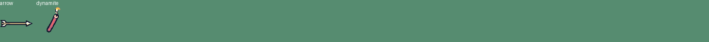

| id | Назва | Що це | Розмір / кадр | Анімації | Ролі |
| --- | --- | --- | --- | --- | --- |
| `weapon/arrow` | Стріла | Стріла лучника: перший кадр летить праворуч, другий застрягла (коротша). Обертати за напрямком польоту. | 64×128 / 64×64 | — | projectile |
| `weapon/dynamite` | Динаміт | Шашка динаміту з ґнотом, що горить; кидає гоблін-підривник. | 384×64 / 64×64 | `play` (6) | projectile |

